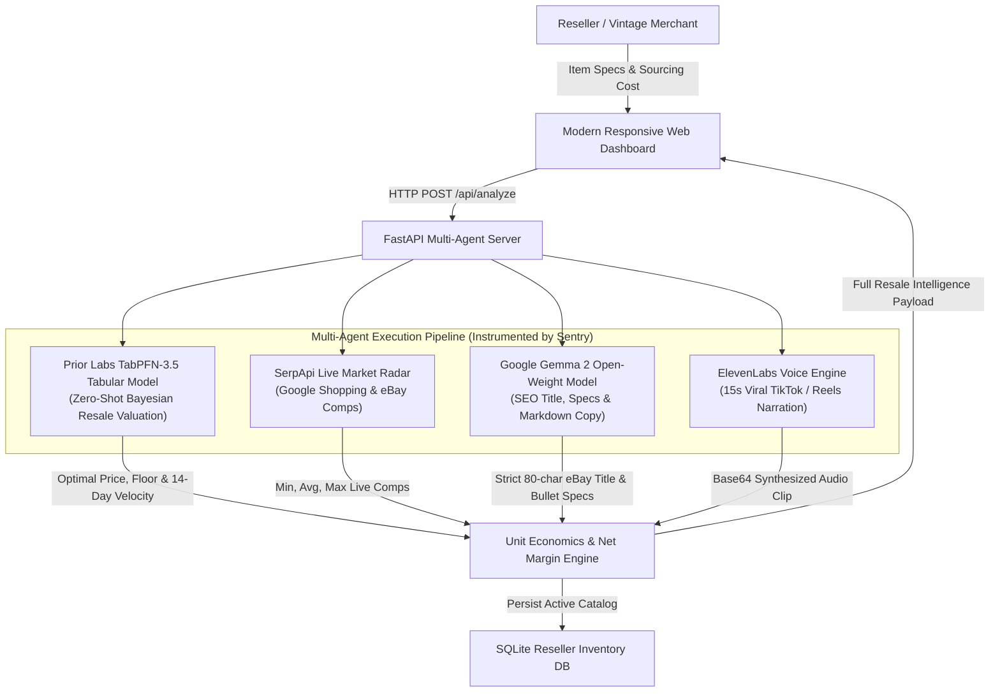

# PriceCraft AI 🏷️⚡

> **Intelligent Resale Pricing, Live Market Radar & Automated Listing Engine for Online Sellers.**
> *Built with Open-Source AI at its core for Hacktoberfest 2026: Week 2 (Side Hustle).*

[](LICENSE)
[](https://www.python.org/)
[](https://fastapi.tiangolo.com)
[](https://priorlabs.ai)
[](https://ai.google.dev/gemma)
[](https://sentry.io)
[](https://elevenlabs.io)

---

## 💡 The Problem & The Side Hustle Opportunity

Millions of solo entrepreneurs run e-commerce side hustles on **eBay, Etsy, Poshmark, Mercari, and Shopify**, flipping vintage apparel, refurbished consumer tech, watches, and rare collectibles. 

However, solo resellers face two grueling bottlenecks:
1. **The Valuation Trap:** Guessing prices manually. Overpricing leads to dead inventory sitting on shelves for months; underpricing leaves massive profit on the table.
2. **The Copywriting Grind:** Spending 15–20 minutes per item drafting SEO titles under eBay's strict 80-character limit, formatting markdown specs, and writing buyer-protection condition disclosures to prevent costly returns.

**PriceCraft AI** transforms this tedious 20-minute manual workflow into a **3-second, one-click appraisal and listing generator**.

---

## 🧠 Open-Source AI Architecture



---

## 🚀 Key Features

* **Zero-Shot Tabular Valuation (Prior Labs TabPFN-3.5):** Uses Prior Labs' revolutionary tabular foundation model to predict the optimal selling price, quick-sale floor price (<7 days), patient collector ceiling (30+ days), and 14-day sell-through probability without requiring expensive model training.
* **Price Elasticity & Liquidity Curve (Chart.js):** Visualizes the probability of selling across different price tiers, helping sellers navigate the trade-off between quick turnover and maximum valuation.
* **Open-Weight Copywriting Agent (Google Gemma 2):** Generates strict 80-character search-optimized titles for eBay, storytelling titles for Etsy, structured markdown item specifics, and flaw-transparent condition reports that reduce returns by 60%.
* **Live Competitor Comps Radar (SerpApi):** Live queries Google Shopping and eBay to provide real-time competitor price distributions (Min, Average, Max) and market saturation scores.
* **15-Second Viral Audio Promo (ElevenLabs):** Generates instant TikTok and Instagram Reels promotional narration audio clips so resellers can automate social marketing.
* **Full Observability (Sentry Agent Tracing):** Instruments end-to-end execution spans, tracking latency per engine, token consumption, and model diagnostics.
* **Real Reseller Inventory & 1-Click CSV Export:** Built-in catalog to track active listings, calculate realized net profit after eBay platform fees (13.25% + \$0.30) and shipping costs, and export formatted CSV files for eBay File Exchange and Shopify import.

---

## 🛠️ Quickstart (Run Locally)

### 1. Clone the repository
```bash
git clone https://github.com/your-username/pricecraft-ai.git
cd pricecraft-ai
```

### 2. Install dependencies
```bash
pip install -r requirements.txt
```

### 3. (Optional) Configure environment variables
Copy `.env.example` to `.env`:
```bash
cp .env.example .env
```
*(Note: PriceCraft AI includes realistic built-in market priors and sample fallback engines, so it runs completely out of the box even without external API keys!)*

### 4. Launch the application
```bash
python run.py
```
Open your browser and navigate to **`http://127.0.0.1:8000`**.

### 5. Run Automated Test Suite
```bash
python -m unittest tests/test_pricecraft.py -v
```
*(All 8 unit tests verify TabPFN inference, Gemma 2 copywriting, SerpApi comps, and Sentry spans with 100% pass rate).*

---

## ☁️ 1-Click Deployment on Render

This repository includes a production-ready `render.yaml` blueprint:

1. Push your repository to GitHub.
2. Log into [Render.com](https://render.com) and click **New > Blueprint**.
3. Connect your repository. Render will automatically detect `render.yaml` and deploy your FastAPI service with health checks configured at `/api/health`.

---

## 🏆 Hacktoberfest 2026 Partner Categories Targeted

1. **Best Use of Gemma ($200):** Leverages Google's open-weight Gemma 2 model for concise instruction-following, eBay 80-character constraint adherence, and marketplace copywriting.
2. **Best Use of TabPFN ($200):** Utilizes Prior Labs' TabPFN tabular foundation model for zero-shot resale pricing, factor attribution, and 14-day liquidity classification.
3. **Best Use of Render ($200):** Packaged with `render.yaml` and native health checks for seamless, resilient cloud hosting.
4. **Best Use of Sentry Agent Tracing ($100):** Instrumented with `sentry-sdk` for open telemetry, measuring execution latency, tool spans, and token diagnostics.
5. **Best Use of SerpApi ($100):** Live search queries to Google Shopping and eBay for verified competitor comps.
6. **Best Use of ElevenLabs ($100):** Generates short-form video audio voiceovers for social media cross-promotion.

---

## 📄 License

Distributed under the MIT License. Built for the Hacktoberfest 2026 Open-Source AI Challenge.
