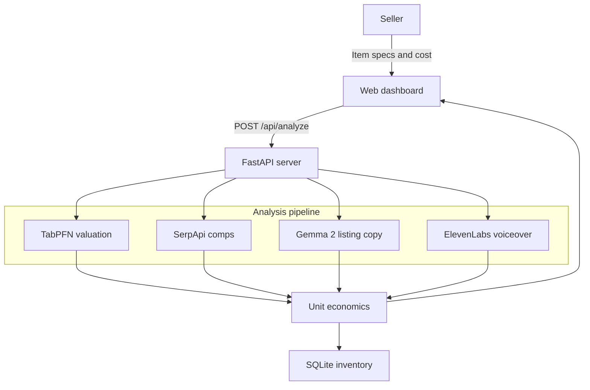

# PriceCraft AI

Intelligent resale pricing, live market comps, and listing generation for online sellers.

**Live demo:** [https://pricecraft-ai.onrender.com](https://pricecraft-ai.onrender.com)

[](https://pricecraft-ai.onrender.com)
[](https://www.python.org/)
[](https://fastapi.tiangolo.com)
[](LICENSE)

Built for Hacktoberfest 2026 (Week 2 — Side Hustle) with open-source AI at the core.

---

## Overview

Solo sellers on eBay, Etsy, Poshmark, Mercari, and Shopify spend too much time on two jobs that should be fast: **pricing** and **listing copy**.

- Guessing a price too high leaves inventory sitting. Guessing too low gives away margin.
- Writing an 80-character eBay title, specs, and an honest condition note often takes 15–20 minutes per item.

PriceCraft AI turns item specs and sourcing cost into a valuation, competitor snapshot, marketplace listing, and optional short-form promo voiceover in one request.

---

## Features

| Capability | What you get |
| --- | --- |
| **Tabular valuation (Prior Labs TabPFN)** | Suggested list price, quick-sale floor, collector ceiling, and 14-day sell-through probability |
| **Liquidity curve** | Chart.js view of sell probability across price tiers |
| **Listing copy (Google Gemma 2)** | eBay-length title, Etsy-style title, markdown specs, and condition disclosure |
| **Live comps (SerpApi)** | Min / average / max competitor prices and a saturation signal |
| **Promo audio (ElevenLabs)** | Short TikTok / Reels-style narration clip |
| **Inventory** | Persist listings, estimate net after typical marketplace fees, export CSV |
| **Observability (Sentry)** | Agent spans for latency and engine diagnostics |

The app includes built-in market priors and fallback engines, so it runs without API keys. Live TabPFN, Gemma, SerpApi, ElevenLabs, and Sentry features activate when the corresponding keys are set.

---

## Architecture



**Stack:** Python 3.11, FastAPI, Uvicorn, SQLite, Tailwind CSS, Chart.js. Production host: [Render](https://pricecraft-ai.onrender.com).

---

## Quick start

### Prerequisites

- Python 3.11+
- `pip`

### Install and run

```bash
git clone https://github.com/ritikahirwar8168-dev/pricecraft-ai.git
cd pricecraft-ai
pip install -r requirements.txt
python run.py
```

Open [http://127.0.0.1:8000](http://127.0.0.1:8000).

### Optional environment

```bash
cp .env.example .env
```

| Variable | Purpose |
| --- | --- |
| `TABPFN_API_KEY` | Prior Labs TabPFN API ([platform.priorlabs.ai](https://platform.priorlabs.ai)) |
| `HF_TOKEN` / `GROQ_API_KEY` | Gemma 2 inference (`GEMMA_MODEL_ID` defaults to `google/gemma-2-9b-it`) |
| `SERPAPI_API_KEY` | Live Google Shopping / eBay comps |
| `ELEVENLABS_API_KEY` | Voiceover generation |
| `SENTRY_DSN` | Agent tracing |
| `ENVIRONMENT` | e.g. `production` |

### Tests

```bash
python -m unittest tests/test_pricecraft.py -v
```

Covers health check, TabPFN valuation, Gemma copy, SerpApi comps, inventory persistence, and related API paths.

---

## Deployment

The production instance is live at **[https://pricecraft-ai.onrender.com](https://pricecraft-ai.onrender.com)**.

This repo includes `render.yaml` (Python 3.11, health check at `/api/health`). To deploy your own copy:

1. Push the repository to GitHub.
2. In [Render](https://render.com), create a new **Blueprint** and connect the repo.
3. Set the optional API keys in the Render dashboard (they are marked `sync: false` in the blueprint).

Health endpoint: `GET /api/health`.

---

## Hacktoberfest 2026

This project is submitted for the Week 2 Side Hustle challenge and uses:

- **Gemma 2** — constrained marketplace copy
- **TabPFN** — zero-shot tabular resale pricing
- **Render** — hosted demo and `render.yaml` blueprint
- **Sentry** — agent tracing
- **SerpApi** — live competitor comps
- **ElevenLabs** — short-form promo audio

---

## License

MIT. Built for the Hacktoberfest 2026 Open-Source AI Challenge.
